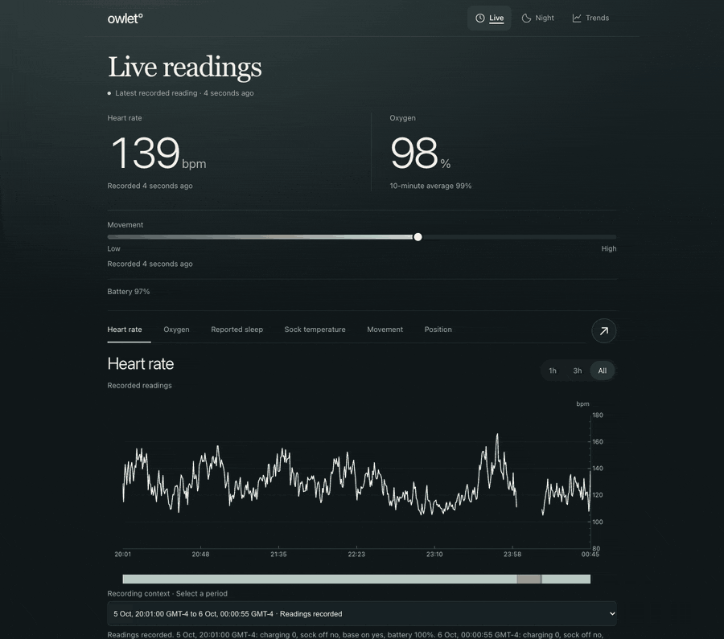

# owlet-recorder

Keep your own record of what an Owlet Dream Sock reports. A small recorder polls
Owlet's cloud every few seconds, writes every reading to SQLite, and a local web
app shows it as three views:

- **Live**: the latest recorded readings, their age, and the last few hours.
- **Night**: one night (local noon to noon) with heart rate, oxygen, reported
  sleep, movement, position and recording gaps.
- **Trends**: nightly percentiles across all the nights you have recorded,
  with drill-through to each night.

Owlet's own app keeps 10-minute averages for about two days. This keeps every
reading for as long as you like.



<sub>Every reading in this walkthrough is synthetic, generated by
`scripts/demo_data.py`.</sub>

> [!WARNING]
> **This is a record, not a monitor.** It reads Owlet's cloud after the fact,
> over the internet, and can stop silently. It raises no alarms. The Owlet app
> and base station remain the only alerting device. Do not rely on this for the
> safety of a child. It is not a medical device.

> [!NOTE]
> Unofficial and not affiliated with or endorsed by Owlet Baby Care, Inc. It
> uses the same undocumented cloud API as the Owlet app, which can change
> without notice.

## Requirements

- An Owlet Dream Sock (sock version 3; tested on `SS3-Sleep`) and its account.
  Both the `europe` and `world` Owlet regions are supported and detected at
  login.
- Python 3.11+ and [uv](https://docs.astral.sh/uv/) (or plain `pip`).
- Something that stays on overnight. A laptop works until its lid closes; a
  Raspberry Pi, NAS or small Linux server is better.

## Quick start

```sh
git clone https://github.com/<you>/owlet-recorder.git
cd owlet-recorder
uv sync

uv run python probe.py        # log in once and print one live reading
```

`probe.py` asks for your Owlet email and password and caches the resulting
tokens in `.owlet_tokens` (mode 0600). Your password is never stored; the
refresh token renews itself. **Treat `.owlet_tokens` like a password**: anyone
with it can read your sock. It is git-ignored.

Then, in two terminals:

```sh
uv run python logger.py --interval 5                 # records to data/owlet.db
uv run python server.py --timezone Europe/Paris      # http://127.0.0.1:8400/
```

`--timezone` (or the `OWLET_TIMEZONE` environment variable) is the IANA zone
that decides where a night starts and ends. It defaults to UTC.

The logger has to keep running to record anything. Owlet does not keep
second-by-second history, so whatever happens while it is stopped is gone.

## Try it without a sock

`scripts/demo_data.py` writes three weeks of synthetic nights, and with
`--live` keeps adding a reading every five seconds, so you can see the app
before connecting an account:

```sh
uv run python scripts/demo_data.py data/demo.db --live &
uv run python server.py --db data/demo.db          # http://127.0.0.1:8400/
```

To re-record the GIF above, see the header of `scripts/record_demo.mjs`.

## Running it on a server

`box/` contains a deploy script and two hardened systemd units for an
always-on Linux host (Debian/Ubuntu). It creates a dedicated `owlet` user with
a `0700` home and a nologin shell. The recorder and web app run as that user,
and the web app binds loopback only.

```sh
uv run python probe.py                               # tokens are created locally
OWLET_HOST=root@my-server OWLET_TIMEZONE=Europe/Paris ./box/deploy.sh
```

| Variable         | Meaning                                                                                 |
| ---------------- | --------------------------------------------------------------------------------------- |
| `OWLET_HOST`     | Required. SSH destination that logs in as root.                                         |
| `OWLET_TIMEZONE` | IANA zone that defines a night. Default `UTC`.                                          |
| `SERVE_PORT`     | If set, publish the dashboard to your tailnet with `tailscale serve --http=$SERVE_PORT`. |
| `OWLET_URL`      | If set, the script verifies the served pages and cache headers at this base URL.       |

Without Tailscale, reach it over an SSH tunnel:

```sh
ssh -N -L 8400:127.0.0.1:8400 root@my-server    # then open http://127.0.0.1:8400/
```

The dashboard has **no authentication**. Keep it on loopback, a tunnel or a
private tailnet. Never bind it to `0.0.0.0` or expose it with Tailscale Funnel.

To change only the front end later, without restarting the recorder:

```sh
OWLET_HOST=root@my-server OWLET_URL=http://my-server:8443 ./box/push-ui.sh
```

It checks that the running server matches your local `server.py`, saves a
rollback bundle on the host, and verifies every served asset hash.

## Files

| File                    | Role                                                                      |
| ----------------------- | ------------------------------------------------------------------------- |
| `owlet_client.py`       | Auth: Firebase -> Owlet mini-token -> Ayla. Caches tokens, never the password. |
| `probe.py`              | One-shot connection test. Prints a live reading and the raw property names. |
| `logger.py`             | Polls vitals, keeps the stream alive, archives summaries and position history. |
| `server.py`             | aiohttp JSON API and the three pages.                                     |
| `summary_decode.py`     | Decodes Owlet's `MONITORING_SUMMARY` protobuf.                            |
| `fetch_summaries.py`    | Archives those summaries before Owlet drops them.                         |
| `position_history.py`   | Archives Owlet's sleep-position history.                                  |
| `box/*.html, *.js, *.css` | The front end. Plotly is vendored, so nothing loads from a CDN.         |
| `box/deploy.sh`, `box/*.service` | Optional server install.                                          |
| `scripts/demo_data.py`  | Synthetic recordings for trying the app and for the README GIF.           |

### HTTP API

| Endpoint                   |                                                       |
| -------------------------- | ----------------------------------------------------- |
| `GET /api/latest`          | Most recent reading, with `age_s` and a `stale` flag. |
| `GET /api/series?hours=12` | Bucketed series; the bucket widens with the range.    |
| `GET /api/nights`          | Per-night statistics.                                 |
| `GET /api/night?night=…`   | One night's trace and summary.                        |
| `GET /healthz`             | 200 if a sample landed in the last 120 s, else 503.   |

`/healthz` returning 503 is the useful signal for external monitoring. It means
the web app is up but nothing is being recorded.

## How Owlet's cloud behaves

These were learned the hard way and shape the whole design.

- **There is no local API on the sock.** The sock talks Bluetooth to the base
  station, the base station uploads to Owlet's cloud, and everything here reads
  from that cloud.
- Vitals arrive as one JSON blob in the `REAL_TIME_VITALS` property, not as
  individual Ayla properties. Older (pre-2021) clients read the old
  per-property model and record nothing against current hardware.
- **There is no history.** `/datapoints.json` caps at 100 rows (about 8
  minutes), silently ignores `filter[created_at_begin]`/`_end`, and its
  `next_page` cursors return the same window forever. If nothing was recording,
  the readings are gone.
- The base station only uploads while an app is marked active, so the logger
  sets `APP_ACTIVE=1` every 60 seconds, as the phone app does. Stop the
  recorder and fresh vitals stop too, unless the phone app is open.
- `sleep_state`: 0 unknown, 1 awake, 8 light, 15 deep.
- `charging` is not a clean boolean (it reads `2` on the base). The server
  derives its own `monitoring` flag instead.

### `MONITORING_SUMMARY`

The one exception to "no history": about two days of 10-minute summaries,
stored as a 4-byte prefix followed by protobuf. The logger archives them every
30 minutes, raw, so a better decoder can re-read them later.

```
1,2  window start (unix)     16,17,18  heart rate min, max, avg
3    window end              19,20,21  SpO2 min, max, avg
4,5  duration (600s)         23        per-minute sleep state (10 values)
```

These were checked against independent 5-second recordings over overlapping
windows: averages agreed within 1–3 units, and field 23 reproduced the recorded
per-minute sleep states exactly. Field 22 is **not** battery. Fields 26 and 27
are fixed-length arrays, probably histograms. All three are left undecoded
rather than guessed.

`docs/research/` holds the longer notes on additional fields, skin temperature,
and the position-history endpoint.

## Privacy

- Recordings are health data. They stay in `data/` on your machine and are
  git-ignored.
- The logger's journal output is a heartbeat with counts only, never vitals.
  `--log-vitals` turns values on for local debugging.
- Nothing is sent anywhere except Owlet's own cloud.

## Tests

The tests run against generated fixtures and never contact Owlet. See
[tests/README.md](tests/README.md).

```sh
uv run python -m unittest discover -s tests -p 'test_*.py'
npm ci && npx playwright install chromium && npm run test:browser
```

## Support

This is a free, volunteer project, maintained on a best-effort basis. There is
no hosted service, no guaranteed uptime and no individual setup support. Owlet
can change its cloud at any time, which may stop recording until the code is
updated. Bug reports and pull requests are welcome; report security problems
privately as described in [SECURITY.md](SECURITY.md).

## Credits

Built on [`pyowletapi`](https://github.com/ryanbdclark/pyowletapi), which
handles Owlet's authentication. Charts use [Plotly](https://plotly.com/javascript/).

## License

[MIT](LICENSE). Bundled third-party code is listed in
[THIRD_PARTY_NOTICES.md](THIRD_PARTY_NOTICES.md).
